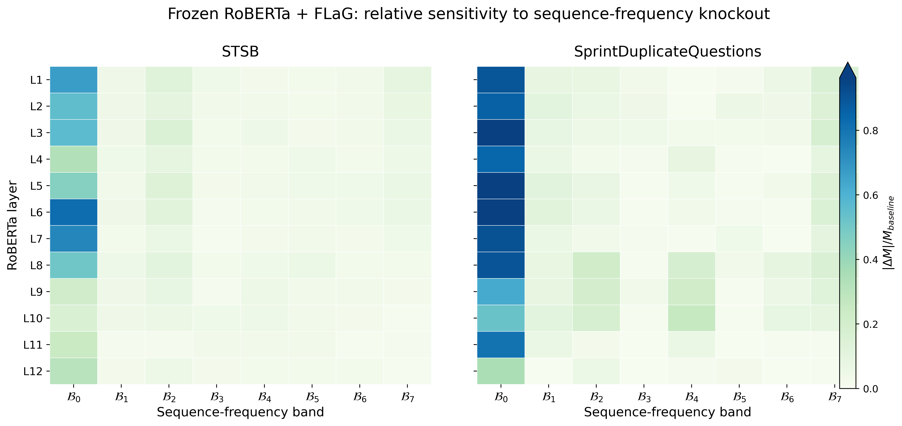
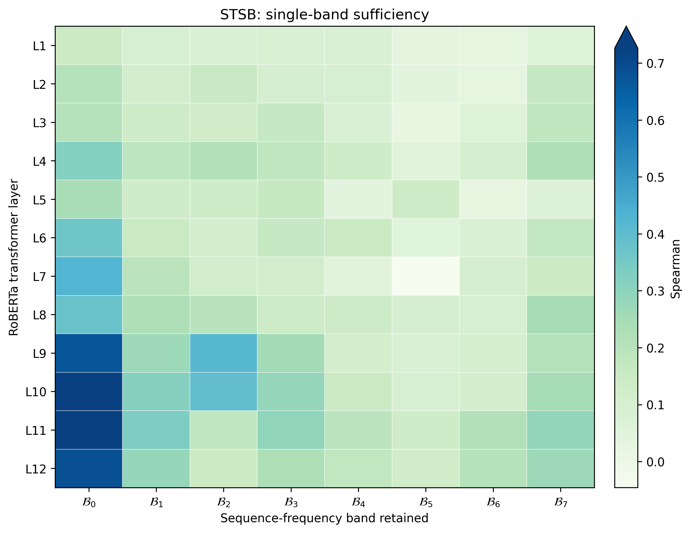
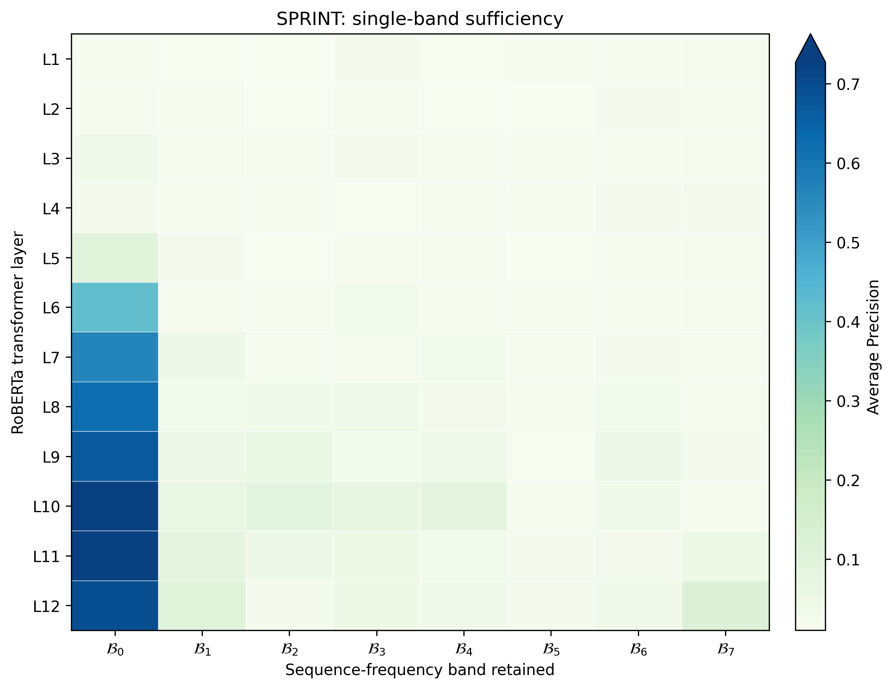

# 最低频带信息与 DC 训练干预

通过逐层 band-knockout、band-only 和从头训练的 DC-only / No-DC 对照，讨论当前模型对最低频成分的依赖。

## 实验总结

  ### 实验二十三：删除不同频带，看看模型最依赖哪一部分

  - **实验目的：** 判断训练好的模型究竟依赖低频信息，还是也依赖其他频率的信息。
  - **实验思路：** 冻结 RoBERTa 和训练好的 FLaG，在不同 Transformer 层删除一个频带，再观察预测性能下降多少。
  - **实验结果：** 最后一层删除 B0 后，STSB 的 Spearman 从 0.710311 降到 0.492913；Sprint 的 AP 从 0.757690 降到 0.493323。两者下降都明显大于删除其他单个频带。
  - **实验结论：** 最后一层删除 B0 使 STSB 和 Sprint 的性能下降最多，表明最低频带是两种任务的重要信息来源。

[查看本实验详细论述](#detail-23)

  ### 实验二十四：如果只保留一个频带，模型还能预测好吗？

  - **实验目的：** 仅通过删除某个频带，不能说明该频带自己是否足够完成任务。因此反过来测试只保留一个频带的效果。
  - **实验思路：** 逐次仅保留一个频带，删除其他频率，使用原有模型预测，不重新训练。
  - **实验结果：** 在最后一层只保留 B0 时，STSB 保留完整模型 96.4% 的 Spearman，Sprint 保留 91.4% 的 AP，明显高于保留其他单个频带。
  - **实验结论：** 只保留最后一层 B0 就能恢复大部分完整模型性能，说明该频带本身已包含大量可供模型使用的任务信息。

[查看本实验详细论述](#detail-24)

  ### 实验二十五：不同 Transformer 层中的低频信息会怎样变化？

  - **实验目的：** 观察 RoBERTa 从浅层到深层，最低频带单独用于预测的效果如何变化。
  - **实验思路：** 在 RoBERTa 不同层分别只保留 B0，观察它还能恢复多少原模型的性能。
  - **实验结果：** STSB 的 B0-only 性能保留比例在 L1 为 20.7%，到 L12 为 96.4%；Sprint 从 L1 的 1.8% 上升到 L11 的 100.4%，L12 为 91.4%。
  - **实验结论：** 越靠近 RoBERTa 的高层，仅保留 B0 通常越能恢复原模型性能，说明深层低频成分已足以支持更强的任务预测。

[查看本实验详细论述](#detail-25)

  ### 实验二十六：训练时只使用 DC，模型还能取得高性能吗？

  - **实验目的：** 前面研究的是训练完成后删除频率。现在进一步判断：如果从训练开始就只让模型看到 DC，是否还能学到有效预测？
  - **实验思路：** 从头分别训练 Full FLaG、No-DC FLaG（去掉 DC）和 DC-only FLaG（仅保留 DC）。三种模型使用相同结构，只改变训练期间可见的频率。
  - **实验结果：** Seed 0 的 Sprint Test AP 分别为 0.724596、0.534044、0.894565。STSB Test Spearman 分别为 0.710535、0.646152、0.746003。
  - **实验结论：** 从训练开始只使用 exact DC，STSB 和 Sprint 的 seed-0 结果都高于 Full FLaG。这说明 DC 中的任务信息可以经可训练模型有效读取，而直接 Mean + cosine 未能充分利用它。

[查看本实验详细论述](#detail-26)

---

## 实验详细论述

### 实验二十三：删除不同频带，看看模型最依赖哪一部分

**实验设置与评价：** STSB test / Sprint validation · seed 0 · 冻结 backbone 的逐层 B0–B7 knockout。

最后一层 L12 删除 B0：STSB 的 Spearman 从 0.710311 降至 0.492913（下降 0.217398，30.6%）；Sprint 的 AP 从 0.757690 降至 0.493323（下降 0.264368，34.9%）。

定义：

\[
\Delta M_{l,k}
=
M_{\text{baseline}}
-
M_{\text{knockout}(l,k)}
\]

其中 \(l\) 为 RoBERTa 层，\(k\) 为频带。

- \(\Delta M>0\)：删除该频带使性能下降；
- \(\Delta M<0\)：删除后反而略有提升，说明该频带在当前 checkpoint 下可能不是正贡献，或存在冗余/干扰。

#### 最后一层 L12

| 任务 | Baseline | 删除 B0 后 | B0 drop | 相对下降 |
| --- | ---: | ---: | ---: | ---: |
| STSB | 0.710311 | 0.492913 | **0.217398** | **30.6%** |
| Sprint | 0.757690 | 0.493323 | **0.264368** | **34.9%** |

STSB L12 各频带：

| Band | Drop |
| --- | ---: |
| **B0** | **0.217398** |
| B1 | 0.015078 |
| B2 | 0.036547 |
| B3 | 0.015344 |
| B4 | 0.021344 |
| B5 | 0.016429 |
| B6 | 0.016766 |
| B7 | 0.008004 |

Sprint L12 各频带：

| Band | Drop |
| --- | ---: |
| **B0** | **0.264368** |
| B1 | -0.001295 |
| B2 | 0.041159 |
| B3 | 0.000924 |
| B4 | 0.014051 |
| B5 | 0.015914 |
| B6 | -0.002491 |
| B7 | -0.007384 |

**结果：两边最后一层都是 B0/DC 明显最重要。** B0 的 knockout 损失远高于任何单个非 DC 频带。

#### B0 dependency 随层变化

STSB 的 B0 knockout drop：

| Layer | Δ |
| ---: | ---: |
| L1 | 0.475 |
| L3 | 0.400 |
| L6 | **0.583** |
| L7 | 0.524 |
| L9 | 0.151 |
| L10 | 0.117 |
| L11 | 0.178 |
| L12 | 0.217 |

STSB 的 DC dependency 在**中层最强**，进入高层后整体减弱，但 L12 仍然明显依赖 DC。

Sprint 的 B0 knockout drop：

| Layer | Δ |
| ---: | ---: |
| L1 | 0.681 |
| L3 | 0.729 |
| L5 | 0.734 |
| L6 | **0.744** |
| L8 | 0.684 |
| L10 | 0.399 |
| L11 | 0.610 |
| L12 | **0.264** |

Sprint 的一个突出特征是：

\[
L11: 0.610
\rightarrow
L12: 0.264
\]

也就是**最后一层 DC dependency 明显下降**。这一模式与 AMP 机制实验中“最终层 DC contribution 骤降”的观察方向相似。

注意到非DC频带

> 在STSB上 的 B1-B7 **几乎全部是正 drop，所有drop里只有一个负数**，说明这些非 DC 成分虽然不如 B0，但基本都在提供正向信息。

> 在Sprint 上**drop正负交替**，每一个频带提供信息抖动，但求和发现带来的整体drop大部分layer上高于STSB任务

> 经过平均计算后，发现Sprint上每一层非DC频带的整体平均值大部分高于STSB，且变化程度高，不如STSB上平缓

本轮采用冻结 RoBERTa 的 seed-0 模型；STSB、Sprint 的评价指标与评估划分不同。B0 指 DCT 频带。

[返回实验 23 的总结](#summary-23)

---

### 实验二十四：如果只保留一个频带，模型还能预测好吗？

**实验设置与评价：** STSB test / Sprint validation · seed 0 · 冻结 backbone 的 band-only。

最后一层仅保留 B0：STSB 的 Spearman 为 0.684905，对应完整模型 0.710311 的 96.4%；Sprint AP 为 0.692524，对应完整模型 0.757690 的 91.4%。

Band-only 与 knockout 正好相反：

\[
H^{(l)}
\rightarrow
DCT
\rightarrow
\text{keep only } B_k
\rightarrow
IDCT
\rightarrow
\text{later layers}
\rightarrow
FLaG
\]

这里**不做 norm restoration**。

对于 L1–L11，保留下来的单频带仍会经过后续 Transformer 层，因此后续层可以重新产生新的频率结构。

因此最干净的直接单频带测试是 **L12**：L12 后面已经没有 Transformer 层，只剩 FLaG。

#### 1 L12：B0 单独几乎可以恢复完整模型

| 任务 | Baseline | B0-only | 保留 baseline 比例 | 最强非 B0 单频带 |
| --- | ---: | ---: | ---: | ---: |
| STSB | 0.710311 | **0.684905** | **96.4%** | B1 = 39.6% |
| Sprint | 0.757690 | **0.692524** | **91.4%** | B7 = 15.0% |

STSB L12：

| Band | Band-only metric | Baseline fraction |
| --- | ---: | ---: |
| **B0** | **0.684905** | **96.4%** |
| B1 | 0.281616 | 39.6% |
| B2 | 0.146808 | 20.7% |
| B3 | 0.226917 | 31.9% |
| B4 | 0.174942 | 24.6% |
| B5 | 0.126907 | 17.9% |
| B6 | 0.210444 | 29.6% |
| B7 | 0.266920 | 37.6% |

Sprint L12：

| Band | Band-only metric | Baseline fraction |
| --- | ---: | ---: |
| **B0** | **0.692524** | **91.4%** |
| B1 | 0.097830 | 12.9% |
| B2 | 0.023563 | 3.1% |
| B3 | 0.047994 | 6.3% |
| B4 | 0.032518 | 4.3% |
| B5 | 0.022983 | 3.0% |
| B6 | 0.033055 | 4.4% |
| B7 | 0.113973 | 15.0% |

这说明 B0/DC 不只是“删掉以后很重要”，而且**单独留下 B0 就已经接近完整模型性能**。

注意到非DC频带

> STSB集上虽然 B0 仍然是绝对主导，但非 DC 频带中仍然分散着更多可用的任务信息。

> Sprint据集上它高度依赖 B0，而且除了 B0 之外，单个非 DC 频带几乎都没有很强的独立预测能力。

---

band-only 的高保留率不能与 band-knockout 的低降幅互相替代；两种干预回答不同问题。

[返回实验 24 的总结](#summary-24)

---

### 实验二十五：不同 Transformer 层中的低频信息会怎样变化？

**实验设置与评价：** STSB test / Sprint validation · seed 0 · 冻结 backbone 的逐层 B0-only。

不同层保留 B0 的指标曲线只在给定 checkpoint 和干预方法下解释：STSB 的 L1 为 20.7%，L12 为 96.4%；Sprint L1 为 1.8%、L11 为 100.4%、L12 为 91.4%。

#### STSB

| Layer | B0-only / baseline |
| ---: | ---: |
| L1 | 20.7% |
| L2 | 29.2% |
| L3 | 28.8% |
| L4 | 44.8% |
| L5 | 34.0% |
| L6 | 51.0% |
| L7 | 60.2% |
| L8 | 53.2% |
| L9 | 94.2% |
| L10 | 102.2% |
| L11 | 103.7% |
| L12 | 96.4% |

#### Sprint

| Layer | B0-only / baseline |
| ---: | ---: |
| L1 | 1.8% |
| L2 | 2.2% |
| L3 | 4.3% |
| L4 | 3.2% |
| L5 | 12.3% |
| L6 | 55.2% |
| L7 | 74.5% |
| L8 | 82.1% |
| L9 | 88.1% |
| L10 | 95.7% |
| L11 | 100.4% |
| L12 | 91.4% |

一个非常明显的共同趋势是：

> **随着 RoBERTa 加深，单独依靠 B0 恢复任务性能的能力迅速增强。**

特别是 Sprint，从 L1 的 1.8% 增长到 L11 的 100.4%，表现得像一个逐层把 task-relevant global information 汇入 B0 的“信息漏斗”。

---

B0-only 保留率来自 seed-0 的逐层替换，不代表频带成分与“语义”之间的一一对应。

[返回实验 25 的总结](#summary-25)

---

### 实验二十六：训练时只使用 DC，模型还能取得高性能吗？

**实验设置与评价：** STSB test / Sprint test（另含 Sprint validation）· seed 0 · 重新训练频率消融模型。

Sprint **official test** AP：Full 0.724596，No-DC 0.534044，DC-only 0.894565。Sprint **validation** AP 是另一组数值：Full 0.757690、DC-only 0.916407，不应混作 test。

#### 实验设计

为了避免“训练时删除 DC”和“只保留 DC”两边模型容量不同，主比较使用三个严格匹配的 frozen-backbone FLaG：

| 条件 | RoBERTa | FLaG | 可见频率 | 是否训练 |
| --- | --- | --- | --- | --- |
| **Full FLaG** | frozen | trainable | \(k=0\) + \(k>0\) | 是 |
| **No-DC FLaG** | frozen | trainable | 仅 \(k>0\) | 是 |
| **DC-only FLaG** | frozen | trainable | 仅 \(k=0\) | 是 |

三个 FLaG 条件的 backbone、模型容量、优化器和训练协议保持一致，唯一变量是 **训练过程中允许模型看到哪些频率**。

实现上：

- No-DC：在真实 rFFT 后将 spec[:, 0] 置零；
- DC-only：保留 spec[:, 0]，其余 spec[:, 1:] 全部置零；
- sanity check 同时验证：
  - No-DC 只改变 \(k=0\)；
  - DC-only 只保留 \(k=0\)；
  - 其它频率不会被连带修改。

#### Seed-0 结果

#### STSB：test Spearman

| 条件 | Spearman | 相对 Full |
| --- | ---: | ---: |
| **Full FLaG** | 0.710535 | 100.0% |
| **No-DC FLaG** | 0.646152 | 90.9% |
| **DC-only FLaG** | **0.746003** | **105.0%** |
| Exact DC / Mean | 0.543549 | 76.5% |

#### Sprint：validation AP

| 条件 | Validation AP | 相对 Full |
| --- | ---: | ---: |
| **Full FLaG** | 0.757690 | 100.0% |
| **No-DC FLaG** | 0.628402 | 82.9% |
| **DC-only FLaG** | **0.916407** | **120.9%** |
| Exact DC / Mean | 0.302018 | 39.9% |

Sprint official test 上：

| 条件 | Test AP |
| --- | ---: |
| **Full FLaG** | 0.724596 |
| **No-DC FLaG** | 0.534044 |
| **DC-only FLaG** | **0.894565** |

这说明 Sprint 上的 DC-only 增益并不只出现在 validation，official test 同样保持。

#### 直接观察

#### STSB

- 训练阶段持续删除 exact DC 后，仍保留约 **90.9%** 的 Full 性能；
- 只保留 exact DC 并训练同一个 FLaG，反而达到 **0.7460**，高于 Full 的 **0.7105**；
- parameter-free Mean 只有 **0.5435**。

因此：

> **DC 中包含很强的 STSB task-relevant information，但“DC 中有信息”不等于“直接 Mean + cosine 就能充分读取这些信息”。**

#### Sprint

- No-DC FLaG test AP 从 **0.7246** 降到 **0.5340**；
- DC-only FLaG test AP 达到 **0.8946**；
- frozen Mean / exact-DC raw readout 只有 validation AP **0.3020**。

因此 Sprint 上更明显地表现出：

> **预训练 RoBERTa 的 final-layer exact DC 中已经存在很强的任务相关信息；专门针对 DC 训练的 FLaG readout 可以把这些信息显著解码出来。**

与此同时：

> **No-DC 仍然能取得不低的性能，说明 non-DC 中也存在可利用信息，但在当前设置下其独立能力明显弱于 DC-only。**

---

只报告这组从头训练的 seed-0 观测；Sprint validation 与 test 的 AP 数字分别列出，不能混用。

[返回实验 26 的总结](#summary-26)

